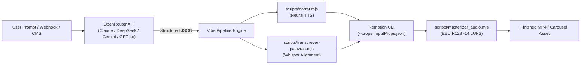

# 🎨🎬 Vibe Design Studio

> **The Headless Creative & Motion Design Studio for AI Agents.**  
> *(Generate agency-grade reels, Hormozi captions, carousels, and motion graphics with zero AI slop, physical spring physics & EBU R128 audio).*

[](https://skills.sh)
[](https://www.remotion.dev)
[](https://www.typescriptlang.org)
[](#-sound-design--audio-mastering-suite)
[](#)
[](#)
[](LICENSE)
[](https://github.com/Gabrielrtads/vibe-design-studio/stargazers)

```bash
# ⚡ 1-Click Install via skills.sh (Claude Code / Codex / Antigravity):
npx skills add Gabrielrtads/vibe-design-studio

# Or generate a vertical reel directly from a script:
pnpm vibe roteiro "Seu roteiro aqui" --vertical --voz thalita --estilo escuro-tech
```

---

## 🛑 The Problem: "AI Slop" in Video & Social Media

When creators ask LLMs to generate videos or carousels, models default to amateur, low-effort patterns:

- ❌ Centered uppercase text floating on blank, flat backgrounds.
- ❌ Generic purple/cyan gradients with zero noise, depth, or tactile texture.
- ❌ Stiff linear animations (`opacity: 0 -> 1`) with zero physical inertia or spring physics.
- ❌ Ear-splitting audio foley (sound impacts $> 0.45$ volume drowning the narrator).
- ❌ Stock footage collage that looks like an obvious bot farm.

**Vibe Design Studio replaces naive prompting with a deterministic Headless Code Studio enforced by linters, mathematical physics, and an automated visual audit loop.**

---

## 🪜 Architectural Philosophy: Floor, Not a Ceiling

A common pitfall when building guardrails for AI is creating a **straitjacket**: rigid constraints that stop weaker/cheaper models from making mistakes, but simultaneously drag top-tier creative models (like Claude Opus 5.5 MAX / Sonnet) down to mediocre, cookie-cutter templates.

**Vibe Design Studio operates under the "Floor, Not a Ceiling" doctrine:**

```
           🚀 CEILING (Non-existent / Infinite Freedom)
              - Bespoke React 18 & Three.js 3D Scenes (@react-three/fiber)
              - Custom GLSL Shaders, Metallic Sheens & VisionOS Glassmorphism
              - Organic Spring Choreography & Variable Typographic Kerning
              - Full Creative License under "Criar do Zero" Route
  ─────────────────────────────────────────────────────────────────
           🛡️ FLOOR (Deterministic Guarantee for ALL Agents)
              - Automated Safe Zones (Instagram 4:5 & TikTok 9:16)
              - Effect-level guard (linter flags SFX above 0.45) & Dynamic Ducking (AutoDuckingAudio, wired into the bundled narrated showcases)
              - Two-Pass EBU R128 Mastering (-14 LUFS +/-0.5 / delivered file at -1 dBTP or lower, measured)
              - Millisecond Whisper Speech Synchronization (words.json)
              - Anti-Slop Linter (Blocks only fatal bugs & audio peaks > 0.45)
```

1. **For Economical / High-Speed Models (Gemini Flash, Haiku):**
   - The studio acts as an unbreakable safety net. Pre-tested templates (`FlowMotionMaster`, `CarrosselEditorial`), automated Whisper ingestion, and strict safe zones prevent the model from outputting unpolished content.
2. **For Top-Tier Creative Models (Claude Opus 5.5 MAX / Sonnet):**
   - The studio acts as a **supercharged launchpad**. The agent does not waste time fighting Chromium memory leaks or calculating loudness decibels.
   - Using the **`[2] Criar do Zero`** route or **`[4] Ingest Reference`**, creative agents have carte blanche to invent entirely new motion choreographies, custom 3D card physics, and agency-level typography.

### 💡 Prompting Quality & Economics at Scale: A Force Multiplier, Not a Miracle Worker

> *"Vibe Design Studio does not do miracles on empty input — but it acts as a massive force multiplier for well-crafted prompts, dramatically elevating what accessible models can deliver."*

* **The Reality of AI Generation:** If you feed a generic prompt like *"make a cool video about tech"*, no engine can invent your creative soul, timing, or narrative tension. While Vibe Design Studio will guarantee zero technical errors (safe zones respected, audio normalized to -14 LUFS, physical spring curves applied), the punchline, rhythm, and visual story rely directly on prompt quality.
* **Elevating Economical Models (Gemini Flash, Haiku, GPT-4o-mini):** The true superpower of Vibe Design Studio is **financial efficiency at scale**. Frontier models are expensive. When you pair rich, intentional prompting with Vibe Design Studio's deterministic floor, **fast, cost-effective models (such as Gemini Flash)** achieve delivery quality comparable to elite creative models. The studio absorbs the technical heavy-lifting (loudness mastering, word-level Whisper sync, spring kinematics), freeing budget-friendly models to focus purely on executing the briefing.
* **Process Over Magic:** It is not a rigid dogma or an imposed rule, but a proven operational insight: **investing two minutes into a crisp, thoughtful prompt unlocks 10x higher aesthetic output while cutting token costs by up to 80% in production scale.**

👉 **Need inspiration?** Read the full [Creative Prompting & High-End Motion Guide](docs/CREATIVE_PROMPT_GUIDE.md) for 3-second hook frameworks, Apple-style design rules, and copy-paste prompt templates for AI agents.

---

## 📊 Market Comparison: Why Vibe Design Studio is Different

| Feature | MoneyPrinter / ShortGPT | Default Remotion | Closed SaaS (Typeframes / Captions) | **Vibe Design Studio** |
|:---|:---|:---|:---|:---|
| **Aesthetic Quality** | 🔴 Low (cropped stock videos) | 🟡 Neutral (depends on prompt) | 🟢 Good (pre-made templates) | **💎 High-End (Apple-Style, Glassmorphism, 3D Tilt)** |
| **Dual Format** | ❌ 9:16 Video only | 🟡 Manual code | ❌ Separate products | **✅ 4:5 Carousels + 9:16 Reels in One Engine** |
| **Reference Ingestion** | ❌ None | ❌ None | ❌ None | **✅ K-Means Palette & Safe Zone Extraction from Link/Print** |
| **Physical Sound Design** | 🔴 Generic background loop | 🟡 Manual audio tags | 🟡 Preset sound effects | **✅ SFX tied to Spring Overshoot Peaks + Auto-Ducking** |
| **Audio Loudness** | 🔴 Inconsistent / Clipped | 🟡 Raw audio | 🟡 Basic compression | **✅ Native EBU R128 (-14 LUFS / -1 dBTP for Reels/TikTok)** |
| **Agent Autonomy** | 🔴 Monolithic Python script | 🟡 Bare framework | 🔴 Closed UI (No CLI/Agents) | **🤖 Native Swarm (Claude, Codex, Gemini via CLI & Mesas)** |
| **Creative Ceiling** | 🔴 Locked templates | 🟢 Freeform code | 🔴 Closed UI walled garden | **🚀 Unconstrained (Three.js, React 18, Custom Shaders)** |
| **Open Source & Extensible** | 🟢 Open source | 🟢 Open source | 🔴 Closed (US$ 30-100/mo) | **🚀 100% Free & Open Source (MIT)** |

---

## 💡 Dual-Engine Capabilities

### 1. 📱 Vertical Motion Videos (9:16 — 1080×1920)
* **Kinetic Typography:** Word-by-word synced highlighting via Whisper (`src/KineticWordCaption.tsx`).
* **3D Camera Rig & Inertia:** Floating isometric cards with simulated lighting (`src/AppleCameraRig.tsx`, `src/AppleKineticCards.tsx`).
* **Physics-Driven Easing:** Calibrated Bézier curves (`snapSettle`, `crashIn`, `popOver`, `bounceHard`, `whip`, `softLand`).

### 2. 📰 Editorial Carousels (4:5 — 1080×1350)
* **Multi-Slide Layout:** Instagram & LinkedIn editorial design (`src/CarrosselEditorial.tsx`).
* **Continuous Marquee Loop:** 0° horizontal conveyor belts for tags and credentials.
* **Native Iridescent SVG:** True gradient typography immune to Chromium multi-thread clipping bugs.
* **Safe Zone Guardrails:** Strict 48px lateral and 80px vertical margins to guarantee zero UI overlap on mobile.

---

## 🌐 Headless API & OpenRouter Pipeline Integration

Can Vibe Design Studio be driven programmatically via external APIs like **OpenRouter**, **OpenAI**, or **Anthropic**?

**Yes, 100%.** Because the engine is completely decoupled from any graphical user interface (headless), it can be plugged directly into automated webhooks, background workers, or backend servers.



### Pattern 1: Feeding via Structured JSON (`inputProps`)
Remotion compositions natively accept arbitrary properties via JSON:

```bash
# Render passing dynamic data generated by an LLM via OpenRouter
npx remotion render Video out/video.mp4 \
  --props='{"title": "O Futuro da IA", "accentColor": "#6366f1", "cards": [{"text": "Alta Performance"}]}' \
  --codec=h264 --crf=16
```

### Pattern 2: End-to-End Orchestrator Script with OpenRouter
You can create a standalone micro-worker (e.g. `scripts/openrouter_worker.mjs`) that consumes OpenRouter:

```javascript
import { execSync } from 'node:child_process';
import fs from 'node:fs';

const OPENROUTER_API_KEY = process.env.OPENROUTER_API_KEY;

// 1. Ask OpenRouter to generate narration script and visual metadata
const response = await fetch("https://openrouter.ai/api/v1/chat/completions", {
  method: "POST",
  headers: {
    "Authorization": `Bearer ${OPENROUTER_API_KEY}`,
    "Content-Type": "application/json"
  },
  body: JSON.stringify({
    model: "anthropic/claude-opus-5.5", // Or google/gemini-2.5-flash for 10x cost reduction
    messages: [
      { role: "system", content: "Retorne um JSON com: { narracao: string, titulo: string, tags: string[] }" },
      { role: "user", content: "Crie um vídeo sobre como o design com código supera ferramentas manuais." }
    ],
    response_format: { type: "json_object" }
  })
});

const { narracao, titulo, tags } = JSON.parse((await response.json()).choices[0].message.content);

// 2. Generate voice + millisecond Whisper alignment
execSync(`node scripts/narrar.mjs "${narracao}" --voz antonio --transcrever`, { stdio: 'inherit' });

// 3. Render and Masterize
execSync(`npm run render:mastered`, { stdio: 'inherit' });

console.log("🎬 Vídeo finalizado com áudio -14 LUFS pronto em out/video_mastered.mp4");
```

---

## 🔊 Sound Design & Audio Mastering Suite

Great video is 50% audio. Vibe Design Studio treats sound as a first-class citizen:

1. **Physical Impact SFX Engine (`src/sound_impact_engine.tsx`):**
   Calculates the exact frame where a spring animation reaches its velocity peak or overshoot (`t ~ 0.15` to `0.27`) and triggers warm sub-impacts, haptic clicks, digital transitions, or whooshes.
2. **Dynamic Auto-Ducking (`src/AutoDuckingAudio.tsx`):**
   Automatically ducks background music down to **10%** during speech and gently ramps it back up to **35%** during pauses, eliminating distracting music clashing.
3. **EBU R128 Mastering (`scripts/masterizar_audio.mjs`):**
   Applies professional two-pass loudness normalization (measure, then linear gain with 0.5 dB headroom for the AAC encoder) (`-14 LUFS`, `LRA: 7`, `True-Peak: -1.0 dBTP`) via FFmpeg so your video sounds punchy and broadcast-ready on mobile speakers without distortion.
4. **1-Click Multi-TTS (`scripts/narrar.mjs`):**
   Zero-cost neural text-to-speech with studio-grade Brazilian Portuguese voices (`antonio`, `francisca`, `thalita`) plus automated Whisper word alignment.

---

## 🛠️ Interactive Studio CLI (`studio_engine.mjs`)

Operate the studio interactively or pipe commands from your AI agent:

```bash
node scripts/studio_engine.mjs
```

```
======================================================
           🎨 VIBE DESIGN STUDIO ENGINE 🎬            
  Headless Motion & Creative Studio for AI Agents     
======================================================

[1] Usar Template Pronto   -> CarrosselEditorial (4:5) ou FlowMotionMaster (9:16)
[2] Criar do Zero          -> Tela Limpa com Safe Zones (sem reciclagem de código)
[3] Ver Habilidades        -> Cromia K-Means, Tipografia Cinética, Cinemática 3D
[4] Ingerir Referência     -> Extrair paleta e geometria a partir de Link/Print
```

---

## 🚀 Quickstart

### 0. Prerequisites

The studio runs on your machine, so install these first (`pnpm vibe doctor` checks them and prints the fix for anything missing):

- **Node.js 24+** and **pnpm** (`npm install -g pnpm`)
- **FFmpeg** with libx264 and libmp3lame (`winget install Gyan.FFmpeg`, `brew install ffmpeg` or `apt install ffmpeg`)
- **Python 3.10+** and its packages: `pip install -r requirements.txt` (numpy for palettes, edge-tts for the free neural voice)
- Internet on the first run: Remotion downloads its headless Chromium, and whisper.cpp installs itself on the first transcription (on Linux/macOS it needs `make` and a C++ compiler)
- On Windows keep the project in a **short path** (for example `C:\vds`): paths over 260 characters break the Remotion binary.

> **License note:** this repository is MIT, but it renders with [Remotion](https://github.com/remotion-dev/remotion/blob/main/LICENSE.md), which is free for individuals, non-profits and for-profit companies with up to 3 employees. Larger for-profit companies need a Remotion company license.

### 1. Clone & Install

```bash
git clone https://github.com/Gabrielrtads/vibe-design-studio.git
cd vibe-design-studio
pnpm install
pip install -r requirements.txt
pnpm setup:pastas   # creates the local folders (audio, input, out/...) - see docs/PASTAS.md
pnpm vibe doctor    # checks everything above; `pnpm vibe ajuda` lists all commands
```

### 2. Generate Narration with 1-Click (Free Neural Voice)

```bash
node scripts/narrar.mjs "O futuro do design não é estático. É código vivo e movimento físico." --voz antonio --transcrever
```

### 3. Render with Mastered Audio (-14 LUFS)

```bash
npm run render:mastered
```

### 4. Script drives the video (1-click, scenes, captions)

```bash
# One sentence = one scene. Captions show YOUR script text (Whisper only lends the timing).
# Each sentence becomes a scene whose visual follows its content: a question gets a big hook,
# a number counts up, the last sentence with an action verb becomes the call to action; no two
# neighbouring scenes repeat. The whole video wears one style pack (colors, caption look, HUD).
pnpm vibe estilos                      # lists the style packs (escuro-tech, editorial-creme, luxo-titanio, ...)
pnpm vibe roteiro "Your script here. Second sentence?" --vertical --voz thalita --estilo editorial-creme --saida out/videos/meu_video.mp4

# Let an agent pick the visual of specific scenes (components from src/timeline/componentCatalog.ts)
echo '[{"cena": 2, "componente": "OrbitalPlanet3D"}]' > plano.json
node scripts/pipeline_script_to_video.mjs "..." --cenas plano.json

pnpm vibe carrossel spec.json --estilo-visual editorial-creme   # static 4:5 carousel: spec JSON -> slide-01.png... + folha.png (see scripts/carrossel.mjs for the spec)
pnpm vibe motion modelos                  # motion graphics WITHOUT narration: pick a closed model (titulo-cinetico, cartao-de-marca, dataviz)
pnpm vibe motion exemplo dataviz > spec.json && pnpm vibe motion spec.json   # copy the example, edit only texts and numbers, render + verify
pnpm vibe reel-gravacao minha_gravacao.mp4 --roteiro "o que eu falei"   # YOUR recording: cuts silence, Hormozi captions, -14 LUFS, verified
pnpm cortar:silencio in.mp4 out.mp4 --simular   # cut dead air from a recording (drop --simular to write the file)
pnpm verificar:video out/videos/meu_video.mp4 --formato 9:16 --folha out/stills   # quality gate: format, fps, -14 LUFS, peak, frozen frames
```

### 4. Run Full Test Suite

```bash
npm run test:unit
```

---

## 🤝 How the Community Can Help

We believe the future of content creation is **open, deterministic code**, not closed SaaS walled gardens. We need your help to make this the gold-standard headless studio for every AI agent on the planet!

Here is how you can contribute:

1. **Submit Viral References:** Found an incredible video on Reels, TikTok, or Dribbble?  
   👉 Open a **[Visual Reference Issue](https://github.com/Gabrielrtads/vibe-design-studio/issues/new?template=visual-reference.yml)** with the URL and keyframes.
2. **Contribute New Templates:**  
   👉 Propose or build a new Remotion composition (e.g., Podcast Clip, SaaS Changelog, Twitter/X thread animated, Pricing Table 3D) via a **[Template Proposal](https://github.com/Gabrielrtads/vibe-design-studio/issues/new?template=template-proposal.yml)**.
3. **Sound Design & Foley Packs:**  
   Help expand our royalty-free core SFX suite (`public/audio/`) with high-fidelity UI sounds and whooshes.
4. **Agent Testing:**  
   Stress-test the studio using Claude Code, Cursor, Codex, or Gemini CLI and report edge cases in our **[Bug Report Form](https://github.com/Gabrielrtads/vibe-design-studio/issues/new?template=bug_report.yml)**.

See our [CONTRIBUTING.md](CONTRIBUTING.md) for full developer guidelines.

---

## 🤖 Agent Integration

Vibe Design Studio includes a native `SKILL.md` compliant with [Claude Code](https://github.com/anthropics/claude-code), [OpenAI Codex](https://github.com/openai/codex), and [Google Antigravity](https://github.com/google/antigravity).

### Install as an Agent Skill:

```bash
git clone https://github.com/Gabrielrtads/vibe-design-studio.git .agents/skills/vibe-design-studio
```

---

## 📁 Repository Structure

```
vibe-design-studio/
├── .github/
│   ├── ISSUE_TEMPLATE/
│   │   ├── visual-reference.yml       # Community reference submission form
│   │   ├── template-proposal.yml      # New React template proposal
│   │   └── bug_report.yml             # Bug report form
│   └── PULL_REQUEST_TEMPLATE.md       # Quality checklist for PRs
├── public/
│   └── audio/                         # Hot Core SFX suite & narration
├── scripts/
│   ├── studio_engine.mjs              # Canonical CLI & Onboarding flow
│   ├── narrar.mjs                     # 1-Click Neural TTS (Edge-TTS pt-BR)
│   ├── masterizar_audio.mjs           # EBU R128 (-14 LUFS) post-processor
│   ├── transcrever-palavras.mjs       # Whisper millisecond word alignment
│   ├── lint-motion-slop.mjs           # Static Anti-Slop AST/regex linter
│   ├── auto_revisar_frames.mjs        # Automated frame review (score >= 8/10)
│   └── references/
│       └── amostrar_paleta.py         # K-Means palette extractor (-vframes 1)
├── src/
│   ├── FlowMotionMaster.tsx           # Vertical 9:16 kinetic benchmark video
│   ├── CarrosselEditorial.tsx         # Editorial 4:5 carousel composition
│   ├── AutoDuckingAudio.tsx           # Dynamic volume sidechain ducking
│   ├── auto_ducking_math.ts           # Zero-dependency volume calculation math
│   ├── sound_impact_engine.tsx        # Physical impact timing engine
│   ├── AppleCameraRig.tsx             # 3D perspective camera drift
│   ├── AppleKineticCards.tsx          # Floating isometric cards
│   ├── KineticWordCaption.tsx         # Synced word highlighting
│   ├── kit.tsx                        # Safe zones, spring physics & typography
│   ├── styles_kit.tsx                 # Shaders, sheens & glassmorphism
│   ├── measured_eases.ts              # Calibrated easing curves
│   └── index.tsx                      # Remotion root entry
├── tests/
│   ├── unit/                          # Zero-dependency node:test suite (89 PASS)
│   ├── e2e/                           # 4-Tier requirement-driven E2E tests (60 PASS)
│   └── python/                        # Palette extraction unit tests (12 PASS)
├── CONTRIBUTING.md                    # Community guidelines
├── package.json
├── PROJECT_TRUTH.md
├── AGENTS.md
├── SKILL.md
└── LICENSE
```

---

## 📜 License

[MIT](LICENSE) © 2026 [Gabriel Toledo](https://github.com/Gabrielrtads)

---

<div align="center">

### ⭐ Impressed with Vibe Design Studio?
If this studio saved your agents from AI slop or helped you produce high-end motion graphics, please star the repository!  
It helps other autonomous agent developers discover the project.

[](https://github.com/Gabrielrtads/vibe-design-studio/stargazers)

---

**Built with pride by [Gabriel Toledo (@Gabrielrtads)](https://github.com/Gabrielrtads)**  
*Creator of [Barber.fi](https://painel.barberfi.com.br), `sta`, `kage-bunshin`, and `agent-log`.*

Licensed under [MIT](LICENSE).

</div>
